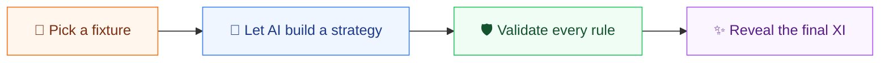
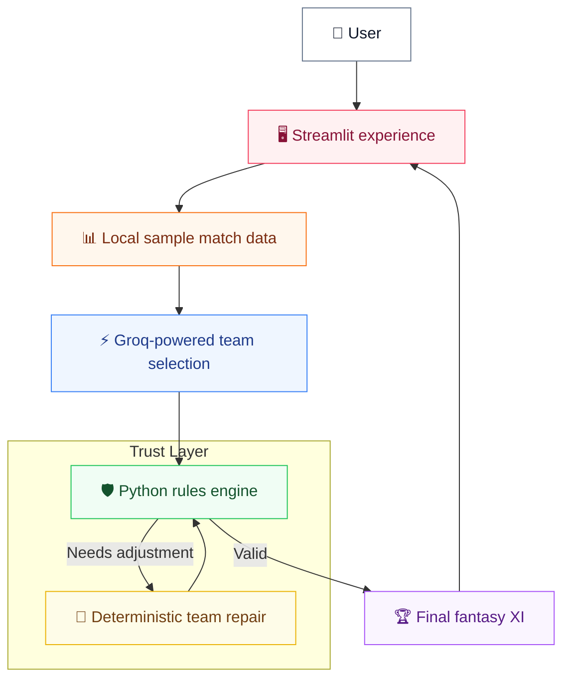

<div align="center">

# 🏏 Dream11 Genie

### From match data to a balanced fantasy XI — in one click.

An AI-powered fantasy cricket team builder that combines creative selection with strict, code-based rule validation.

[](https://www.python.org/)
[](https://streamlit.io/)
[](https://www.langchain.com/langgraph)
[](https://groq.com/)
[](#quality--trust)

> A portfolio project exploring how generative AI and deterministic software can work together: AI makes the creative choices; Python makes sure every team follows the rules.

</div>

---

## ✨ The big idea

Building a fantasy XI sounds simple—until credits, player roles, team limits, captaincy, and recent form all compete at once. Dream11 Genie turns that puzzle into a clean four-step experience:



The result includes a complete 11-player lineup, captain and vice-captain, role balance, total credits, a reason for every selection, and a short overall strategy.

## 💡 Why it stands out

| | Experience |
|---|---|
| 🧠 **AI-powered selection** | Uses match context, recent form, player roles, and sample pitch conditions to shape a lineup. |
| 🛡️ **Rules you can trust** | Python checks squad size, credits, role balance, team limits, duplicates, and captaincy. |
| 🔧 **Automatic repair** | If the generated XI breaks a constraint, a deterministic repair step rebuilds it safely. |
| 💬 **Explainable picks** | Every player comes with a simple, human-readable reason. |
| ⚡ **Fast, focused flow** | One compact AI request—no hidden retry loop and no unnecessary calls. |
| 🎓 **Built for learning** | Switch between a direct demo and the same flow visualized as a LangGraph agent. |

## 🏗️ How the pieces work together



The key design choice is simple: the language model suggests a team, but it never gets the final word on hard constraints. A conventional rules engine validates the XI before it reaches the screen.

## 🚀 Run it locally

### 1. Clone and enter the project

```bash
git clone https://github.com/DennyM55/dream11-genie.git
cd dream11-genie
```

### 2. Create an environment and install dependencies

```bash
python -m venv .venv
```

Activate it on Windows:

```powershell
.\.venv\Scripts\Activate.ps1
```

Or on macOS/Linux:

```bash
source .venv/bin/activate
```

Then install the project:

```bash
python -m pip install -r requirements.txt
```

### 3. Add your Groq API key

Copy `.env.example` to `.env`, then replace the placeholder with your key:

```env
GROQ_API_KEY=your_groq_api_key_here
```

### 4. Launch the app

```bash
python -m streamlit run app.py
```

## 🧪 Quality & trust

The project includes an offline test suite covering response parsing, team validation, deterministic repair, request limits, error handling, and the Streamlit experience—without making live provider calls.

```bash
python test_offline.py
python -m pip check
```

## 🧰 Built with

`Python` · `Streamlit` · `Groq` · `LangGraph` · `Pydantic`

## ☁️ Deploying on Streamlit Community Cloud

Use `app.py` as the entry point, select Python 3.12, and add `GROQ_API_KEY` in the app's secret settings. No database or additional service is required.

> [!NOTE]
> Dream11 Genie is an educational demo built with illustrative local sample data. It does not use live cricket statistics and is not betting or financial advice. Public deployments use the owner's API quota.

---

<div align="center">

**Strategy from AI. Rules enforced by code. A fantasy XI explained to everyone.**

Made with 🏏, curiosity, and a healthy respect for the 100-credit limit.

</div>
